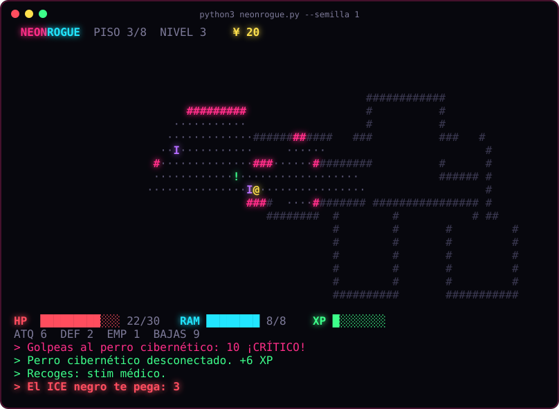

<div align="center">



### Infíltrate en la torre, baja 8 pisos y roba el núcleo de datos. En tu terminal.




</div>

## ▶️ Jugar

```sh
python3 neonrogue.py              # torre al azar
python3 neonrogue.py --semilla 42 # misma semilla = misma torre (para competir)
```

Terminal de 80×28 como mínimo. Si tu terminal tiene 256 colores, se ve en neón de verdad.

## 🕹️ Controles

| Tecla | Acción |
|---|---|
| flechas / `h j k l` | moverse (chocar = atacar) |
| `y u b n` | diagonales |
| `a` | **quickhack**: gasta 3 de RAM y daña a todos los enemigos a la vista |
| `e` | **granada EMP**: aturde 4 turnos a todos los que ves |
| `>` | bajar por el ascensor |
| `.` | esperar · `?` ayuda · `q` salir |

## 🤖 Enemigos y botín

`d` dron · `p` pandillero chrome · `c` perro cibernético · `I` ICE negro · `M` mech de asalto · `A` IA rebelde, y en el piso 8 la **IA guardiana** cuida el núcleo.

`!` stim · `%` chip de RAM · `?` EMP · `/` mejora de brazo · `[` placa subdérmica · `$` eddies

## ⚙️ Por dentro

- Pisos generados con salas y túneles; cada piso cambia el color de las paredes.
- **Campo de visión** con líneas de Bresenham (el mapa recuerda lo que ya viste).
- Enemigos que te persiguen cuando te ven, críticos, subida de nivel y puntaje final.
- Todo en un archivo: `neonrogue.py`.

<div align="center"><sub>NEONROGUE · hecho por <a href="https://github.com/NeckHurtttt">NeckHurtttt</a></sub></div>
